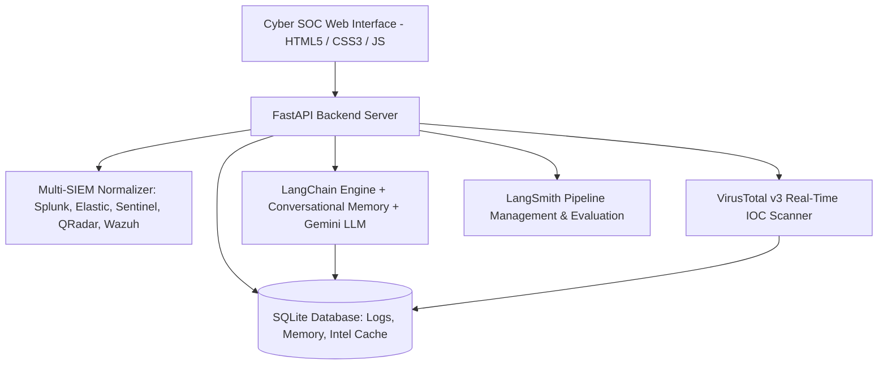

# 🛡️ Multi-SIEM SOC Copilot

An AI-powered Security Operations Center (SOC) Copilot and Threat Intelligence Hunting Engine leveraging **Google Gemini LLM**, **LangChain** conversational memory, **SQLite** data management, real-time **VirusTotal v3** threat detection, and **LangSmith** pipeline evaluation across multiple SIEM tools.


---

## 🌟 Key Features

1. **Multi-SIEM Ingestion & Normalization**:
   - Ingests and standardizes log telemetry from:
     - **Splunk**: CIM, Syslog KV, Windows EventLog (4768, LSASS, Mimikatz), Cisco ASA, Suricata.
     - **Elastic / ELK**: Elastic Common Schema (ECS) JSON (Sysmon process creation, Packetbeat DNS exfiltration).
     - **Microsoft Sentinel**: Azure SecurityAlert and CommonSecurityLog (Phishing token replay, Defender Ransomware file encryption).
     - **IBM QRadar**: Log Event Extended Format (LEEF 2.0) with tab-delimited attribute extraction.
     - **Wazuh / OSSEC**: Host intrusion detection JSON alerts (SSH brute force, VSS Shadow Copy purging).
   - Ingest logs via file upload (`.json`, `.csv`, `.log`) or raw log pasting with auto-format detection.

2. **Memory-Enabled Response Engine (LangChain + Gemini API)**:
   - Grounded context injection matching queries against ingested SIEM events and VirusTotal reputations.
   - Multi-turn conversational memory retaining prior context, compromised entities, and past investigation steps.
   - Powered by `gemini-3.6-flash` via `langchain-google-genai` with fallback reasoning.

3. **VirusTotal v3 Threat Intelligence Engine**:
   - Real-time IOC extraction for public IPv4s, SHA-256/MD5 hashes, and domains.
   - Live querying with vendor consensus breakdown (e.g. 68/88 malicious engines) and SQLite caching.

4. **LangSmith Pipeline Management & Evaluation**:
   - Live distributed tracing of prompts, tool latency, token usage, and errors.
   - Built-in evaluation benchmark suite verifying IOC extraction, severity normalization, VirusTotal consensus, memory recall, and parser fidelity.

5. **Cyber-SOC Web Interface**:
   - Sleek dark-mode SOC dashboard with real-time telemetry counters.
   - Multi-turn hunting chat, multi-SIEM log explorer with inspector modal, IOC scanner with reputation gauges, MITRE ATT&CK kill-chain matrix, and LangSmith evaluation monitor.

---

## 🏗️ Architecture



---

## 🚀 Quick Start

### 1. Clone the Repository
```bash
git clone https://github.com/shreenithi23/soc-copilot.git
cd soc-copilot
```

### 2. Configure Environment Variables
Copy `.env.example` to `.env` and fill in your API credentials:
```bash
cp .env.example .env
```
Edit `.env`:
```ini
# Google Gemini API Key
GEMINI_API_KEY=your_gemini_api_key_here

# VirusTotal API v3 Key
VIRUSTOTAL_API_KEY=your_virustotal_api_key_here

# LangSmith Configuration
LANGCHAIN_TRACING_V2=true
LANGCHAIN_API_KEY=your_langsmith_api_key_here
LANGCHAIN_PROJECT=soc-copilot
LANGCHAIN_ENDPOINT=https://api.smith.langchain.com
```

### 3. Launch the Application
Run using the automated shell script:
```bash
./run.sh
```
Or manually with Python:
```bash
python3 -m venv venv
source venv/bin/activate
pip install -r requirements.txt
python start.py
```

Open your browser to: **`http://localhost:8000`**

---

## 🧪 Testing & Evaluation

### Run Automated Unit Tests:
```bash
python -m unittest tests/test_app.py
```

### Run Live System Benchmarks:
```bash
python test_full_system.py
```

---

## 📂 Project Structure

```
soc-copilot/
├── app/
│   ├── api/
│   │   ├── __init__.py
│   │   └── routes.py            # FastAPI REST endpoints
│   ├── config.py                # Environment & settings management
│   ├── database.py              # SQLite storage for logs, memory & cache
│   ├── langsmith_eval.py        # LangSmith benchmark evaluation suite
│   ├── llm_engine.py            # LangChain + Gemini LLM conversational engine
│   ├── main.py                  # FastAPI application entrypoint
│   ├── seed_data.py             # Realistic multi-SIEM APT & ransomware dataset
│   ├── siem_parser.py           # Splunk, Elastic, Sentinel, QRadar, Wazuh parsers
│   └── threat_intel.py          # VirusTotal v3 IOC scanner & cache
├── static/
│   ├── css/
│   │   └── style.css            # Dark cyber SOC theme & glassmorphism
│   ├── js/
│   │   └── app.js               # Reactive frontend logic
│   └── index.html               # Main single-page application
├── tests/
│   └── test_app.py              # Unit tests
├── .env.example                 # Environment configuration template
├── .gitignore                   # Excludes secrets, venv, and databases
├── requirements.txt             # Python dependencies
├── run.sh                       # Quick-launch bash script
├── start.py                     # Python entrypoint runner
└── test_full_system.py          # End-to-end integration test runner
```

---

## 📄 License
MIT License
